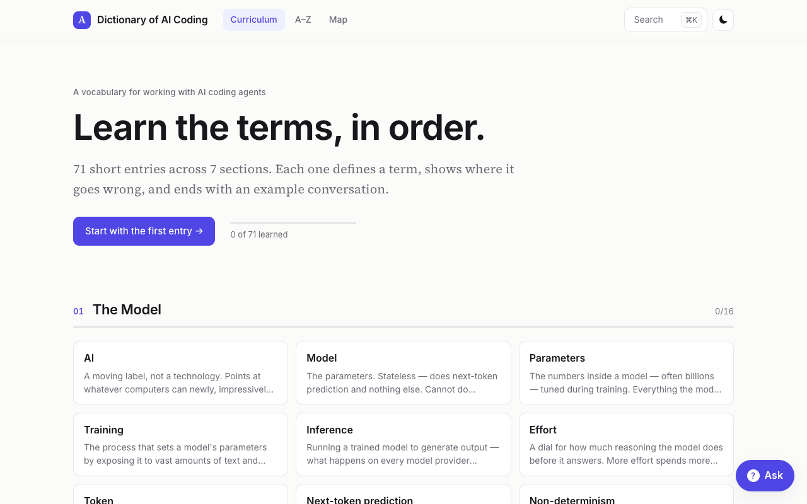
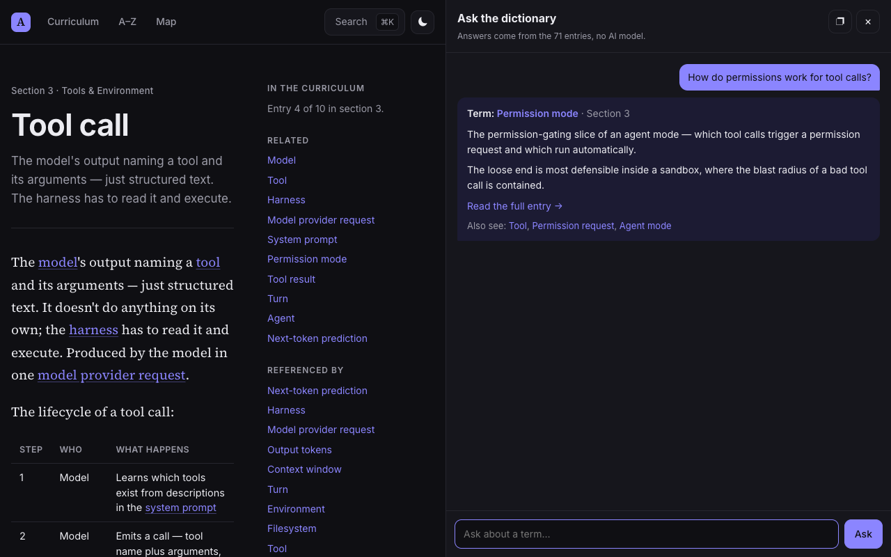
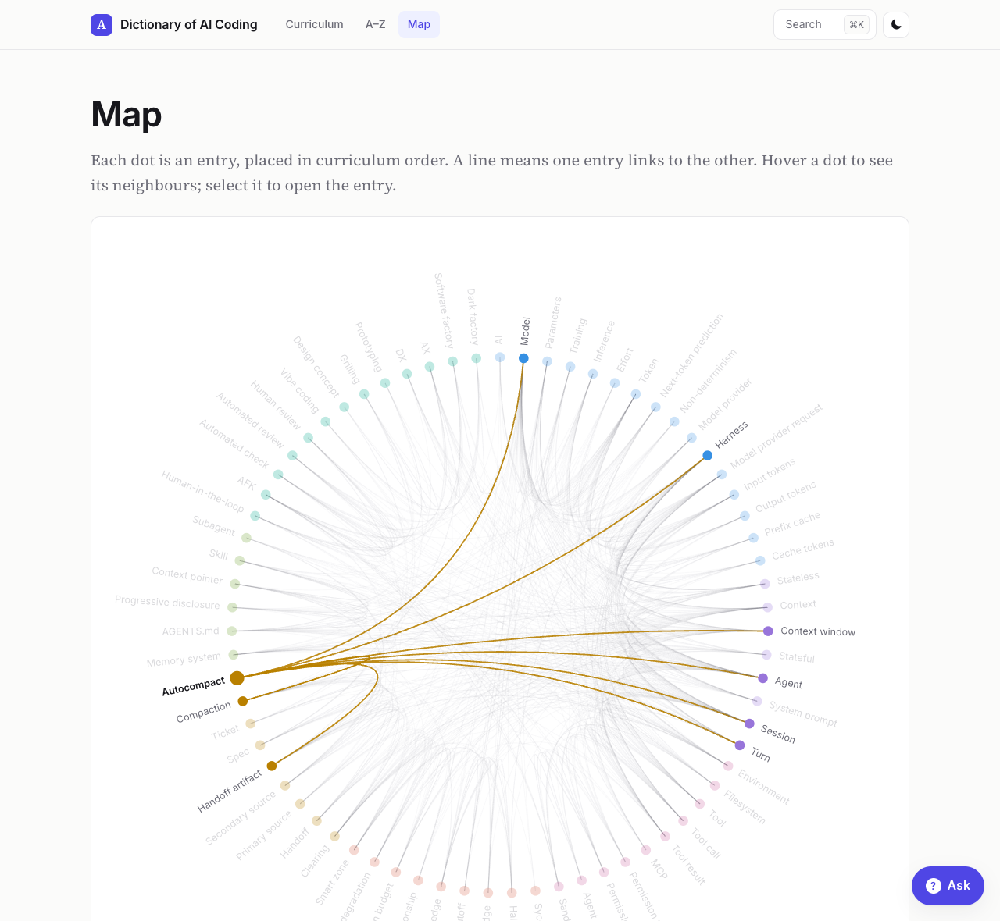

# Dictionary of AI Coding: Learning Site

An interactive site for learning the vocabulary of working with AI coding agents. It presents the 71 entries of the [AI Coding Dictionary](https://github.com/mattpocock/dictionary-of-ai-coding) as an ordered curriculum, with search, a link map, progress tracking, and an offline question-answering panel that needs no AI model.

**Live site:** https://ai-coding-dictionary.techguidebro.workers.dev



## Features

| Feature | What it does |
| --- | --- |
| **Curriculum home** | Seven sections in teaching order, each with a progress bar. A Continue button opens the first entry you haven't marked as learned. |
| **Entry pages** | A single reading column with the definition, a styled Usage dialogue, previous/next navigation, and a side rail listing Related entries and Referenced by. |
| **Learned tracking** | A manual toggle on every entry. Progress is stored in the browser's `localStorage`: no account, no server. |
| **Search** | Press `⌘K` / `Ctrl+K` or `/` to search titles, descriptions, bodies, and usage text. Matching is prefix- and typo-tolerant. |
| **Map** | A circular diagram of every link between entries, ordered by curriculum position and coloured by section. Hover a dot to highlight its neighbours; select it to open the entry. |
| **Ask panel** | A floating button opens a question box. It names the matching term, quotes the most relevant sentences from the entry, and links to related terms. Runs in the browser in a few milliseconds, with no model and no network call. |
| **Split view** | A button on the Ask panel docks it to the right half of the window, so you can read an entry while asking questions. |
| **A–Z index** | Every entry listed alphabetically with its description. |
| **Light and dark mode** | Follows the system setting by default, with a manual toggle. The choice is applied before first paint, so there is no flash. |
| **Build-time validation** | The build fails on a broken entry link, an entry missing from the curriculum, a duplicate term, or missing frontmatter. |





## How it works

The site is a static single-page app. It has no backend and no database.

```
dictionary/*.md ─┐
                 ├─► web/scripts/content.ts ─► web/src/generated/content.json ─► React app ─► web/dist
internal/        │      parse + validate
  Curriculum.md ─┘
```

1. **Content pipeline.** `web/scripts/content.ts` reads `internal/Curriculum.md` for section order and `dictionary/*.md` for entries. It parses frontmatter, rewrites relative links such as `./Tool call.md` into routes, splits off the Usage dialogue, and records which entries link to which. Any problem stops the build.
2. **React app.** Vite builds a TypeScript React app that imports the generated JSON. Entry text is rendered with `react-markdown` and `remark-gfm`.
3. **Hosting.** The `dist` folder is deployed to Cloudflare as static assets, with single-page-app fallback so deep links such as `/entry/token` resolve.

### How the Ask panel answers

| Step | What happens |
| --- | --- |
| 1 | The question is checked for entry titles, allowing plurals. "What is a token?" matches **Token**. |
| 2 | If the question contains words beyond the term itself, those words are searched across all entries and decide the term. "Why does the agent forget things?" resolves to **Attention budget**, not **Agent**. |
| 3 | The entry's body is split into sentences, and the ones sharing the most words with the question are picked. |
| 4 | The answer shows the term, its section, the description, the picked sentences, a link to the full entry, and up to three related terms. |

It is keyword matching over a fixed text. A question worded very differently from the entries can land on a loosely related term, and a question with no matching words gets a short "no match" message.

## Project structure

```
.
├── dictionary/            # The entries (markdown, one per term)
├── internal/
│   ├── Curriculum.md      # Section order and the entries in each
│   ├── CONTEXT.md         # Project vocabulary
│   └── generate-readme.ts # Builds DICTIONARY.md
├── web/                   # The learning site
│   ├── scripts/content.ts # Content pipeline
│   ├── src/
│   │   ├── pages/         # Home, entry, A–Z, map
│   │   ├── components/    # Search palette, Ask widget, progress bar
│   │   └── lib/           # Content access, search, ask, learned state, theme
│   └── wrangler.jsonc     # Cloudflare deployment config
├── docs/images/           # README screenshots
└── DICTIONARY.md          # The full dictionary as one page (generated)
```

## Tech stack

| Area | Choice |
| --- | --- |
| UI | React, TypeScript |
| Build | Vite |
| Routing | React Router (history mode) |
| Markdown | `react-markdown`, `remark-gfm` |
| Search and Ask | MiniSearch |
| Styling | Plain CSS with custom properties |
| Fonts | Source Serif 4 and Inter, self-hosted through Fontsource |
| Hosting | Cloudflare static assets, deployed with Wrangler |

## Getting started

Requires Node.js 22 or later.

```bash
git clone https://github.com/parthd575/dictionary-of-ai-coding.git
cd dictionary-of-ai-coding/web
npm install
npm run dev
```

The dev server prints a local URL. Content is read when `npm run dev` starts, so restart it after editing an entry.

### Scripts

Run these from `web/`.

| Command | Purpose |
| --- | --- |
| `npm run dev` | Parse content, then start the Vite dev server |
| `npm run content` | Parse and validate content only |
| `npm run build` | Parse content, typecheck, and build to `web/dist` |
| `npm run preview` | Serve the production build locally |
| `npm run deploy` | Build, then publish to Cloudflare with Wrangler |

## Deploying to Cloudflare

1. Log in to the Cloudflare account you want to deploy to: `npx wrangler login`. Run `npx wrangler whoami` to confirm the account.
2. From `web/`, run `npm run deploy`.

The worker name is set in `web/wrangler.jsonc` (`ai-coding-dictionary`). The site is served from that worker's `workers.dev` address unless you attach a custom domain.

## Adding or editing an entry

1. Add or edit a file in `dictionary/`. Each entry needs a `description` in its frontmatter of fewer than 140 characters, and at least 200 words across the body and the Usage dialogue.
2. Link other entries with relative links such as `[tool](./Tool.md)`. Link a term only on its first appearance in an entry.
3. Add new entries to `internal/Curriculum.md` under the right section. The build fails if an entry is missing there.
4. Regenerate the single-page dictionary from the repository root: `npm install && npm run generate`. A git pre-commit hook does this automatically, and a GitHub Action checks that `DICTIONARY.md` is up to date.
5. Rebuild the site with `npm run build` in `web/`.

## Credits

The dictionary content is by [Matt Pocock](https://github.com/mattpocock) and is published at [aihero.dev/ai-coding-dictionary](https://www.aihero.dev/ai-coding-dictionary); this repository is a fork of [mattpocock/dictionary-of-ai-coding](https://github.com/mattpocock/dictionary-of-ai-coding). The learning site in `web/` was built on top of it.

The upstream repository does not include a licence file, so no licence is granted here for the dictionary text. Check with the original author before reusing it.
